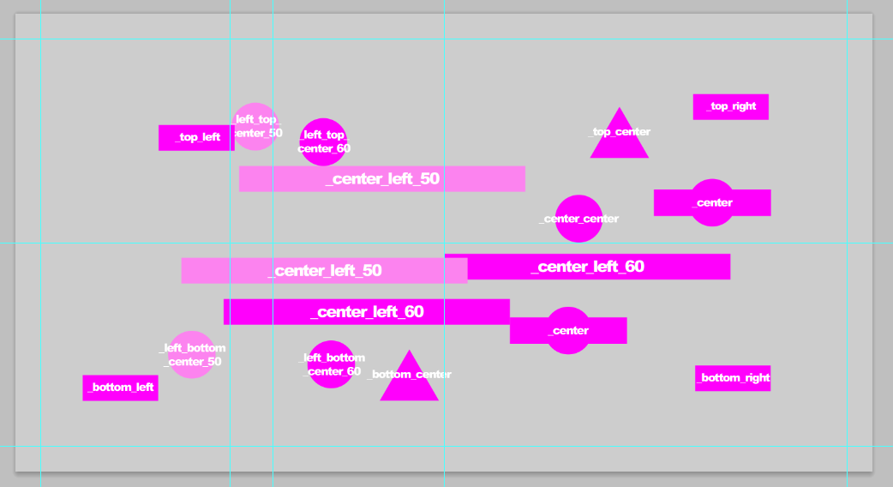
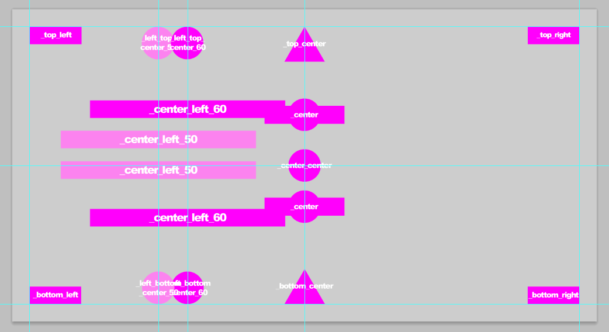

# Photoshop Batch Resize

An ExtendScript (JavaScript) tool for Adobe Photoshop that declines master PSD files into a list of
pixel sizes — the Photoshop counterpart of my
[InDesign batch resize](https://github.com/kowalschi/indesign-batch-resize) script, used for digital
campaign formats (social, programmatic banners, stories).

## What it does

1. Reads the working folder of the open document and finds the **master PSDs** (at least landscape,
   square and portrait; more masters give better results).
2. Reads a **tab-delimited text file** exported from Excel with `name`, `width`, `height` in pixels.
3. For every row it picks the master with the closest aspect ratio, scales it with Image Size on the
   limiting side and extends the canvas to the exact target size.
4. Adds a top layer with a magenta outline showing the original master edge, so the designer sees
   at a glance what has to be rearranged.
5. Saves each new format as a PSD in a `result` folder.

`arrange_elements_in_canvas.jsx` is the second step: it places guides and aligns layers inside the
new canvas according to suffixes in the layer names (for example `_logo_left_top_center`).

| Before | After |
|---|---|
|  |  |

## Usage

1. Put the master PSDs and one `.txt` list (see `declinari.example.txt`) in the same folder — no
   other PSD or TXT files.
2. Open any master in Photoshop.
3. Run `photoshop_batch_resize.jsx` (File → Scripts → Browse).

## License

Published for portfolio and demonstration purposes. Please ask before reusing the code.

© Dan Ichimescu
